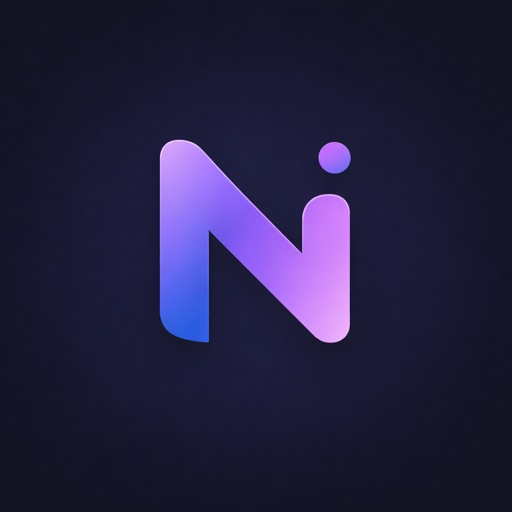

  
  <h1>Hi, I'm Birol</h1>
  
Full-stack developer from Bursa, Türkiye. I build web apps with React and Spring Boot, and I've shipped my own apps to the App Store and Microsoft Store.

  
<a href="https://birolweb.dev">Website</a> · <a href="https://www.linkedin.com/in/birol-bulut">LinkedIn</a> · <a href="mailto:birolblood@gmail.com">Email</a>

## Apps I've published

<table>
  <tr>
    <td width="33%" valign="top">
      
      <h3><a href="https://apps.apple.com/app/id6835477567">Blobnap</a></h3>
      
A color puzzle game with global and per-country leaderboards. Capacitor, Supabase, AdMob.

      
<a href="https://apps.apple.com/app/id6835477567">App Store →</a>

    </td>
    <td width="33%" valign="top">
      
      <h3><a href="https://apps.apple.com/app/id6761790991">Nudgio</a></h3>
      
Birthday and date reminders with gift ideas, in six languages. React, Capacitor, Supabase.

      
<a href="https://apps.apple.com/app/id6761790991">App Store →</a>

    </td>
    <td width="33%" valign="top">
      
      <h3><a href="https://apps.microsoft.com/detail/9NLT1JT7R800">Setyra</a></h3>
      
Sets up a new Windows PC: apps, settings and services. C#, .NET, WPF.

      
<a href="https://apps.microsoft.com/detail/9NLT1JT7R800">Microsoft Store →</a>

    </td>
  </tr>
</table>

## Projects

| Project | What it is | Stack | Links |
| --- | --- | --- | --- |
| **ServiceFlow** | Field service platform with customer, admin and technician roles | Java, Spring Boot, React, PostgreSQL, JWT | [Demo](https://serviceflow-web-ten.vercel.app/) · [Code](https://github.com/bulutbirol/FSM-Platform-Project) |
| **Shortlink** | URL shortener with click stats; redirects run on a Cloudflare Worker | Spring Boot, React, PostgreSQL, Docker | [Demo](https://shortlink-web-eight.vercel.app/) · [Code](https://github.com/bulutbirol/Link-Shortener) |
| **SMMM Soru Bankası** | Exam practice app with 2,700+ questions from 21 past exams | React, Vite, Tailwind CSS | [Demo](https://smmm-soru-bankasi.vercel.app/) · [Code](https://github.com/bulutbirol/Soru-bankasi) |
| **birolweb.dev** | My portfolio, English and Turkish, prerendered for SEO | React, Vite, Tailwind CSS, PHP | [Site](https://birolweb.dev) · [Code](https://github.com/bulutbirol/Portfolyo-g-ncel) |

## What I work with

- **Frontend:** JavaScript, React, Redux Toolkit, React Query, Tailwind CSS
- **Backend:** Java, Spring Boot, Spring Data JPA, REST APIs, Node.js, PHP
- **Data:** PostgreSQL, MySQL, Supabase
- **Mobile & desktop:** Capacitor, C# / .NET
- **Tools:** Git, GitHub Actions, Docker, Vercel, Render, Cloudflare Workers, Cypress, Vitest

  Most of my Workintech coursework is in the other <a href="https://github.com/bulutbirol?tab=repositories">repositories</a>.

